# Interface modes

Settings → Appearance → **Interface** picks how the window is laid out: **Standard**, or one of two
minimalist layouts, **Zen** and **Mono**. It is a separate choice from the color theme. Every theme
works in every mode, and View in the menu bar and the command palette ("Switch to the … interface")
switch it too.

## What each mode is

**Standard** is the full layout: a labelled sidebar, the session header, the side panel and the
File / Edit / View / Help menu bar.

**Zen** — one calm column. Chrome stays quiet until it is reached for.

- Sessions are a rail of dots. Each dot takes its harness's hue, carries a ring when its session is
  open, an accent fill when it finished unseen, and breathes blue while working or red while waiting
  on you. A pinned session's dot is a rounded square. Folders are short rules. Hovering the rail (or
  tabbing into it) slides the full list open over the conversation.
- The conversation is one centered reading column. Your messages read as lines with an accent rule
  rather than bubbles. A turn's work is its bare numbers (`2m 34s · 4 · ±2`). A completed turn's
  footer appears only when pointed at; a failed or interrupted one stays visible.
- The composer is a floating pill. Its model, permission, attach and voice controls appear when you
  point at it or tab into them; Send never hides.
- The side panel is a drawer floating beside the column, with icon tabs. The column moves out of its
  way rather than hiding under it.
- The title bar keeps only the menu, where you are and Vesta. Back and forward appear when the bar is
  pointed at. Settings becomes an icon rail with an expanding search.

**Mono** — a terminal-like grid.

- Monospace type, square corners and hairline rules throughout.
- Sessions are tabs across the top, grouped under `folder/` prefixes. Each tab leads with a state
  glyph: `○` idle, `●` open, `◆` running, `!` waiting on you, `×` failed. A mouse wheel scrolls the
  strip sideways and the open session's tab is kept in view. Clicking a tab opens it; rename by
  double-click or the context menu.
- The session header is a one-line status bar: title, `[harness]`, `~/folder`, branch and changes.
- The transcript is a log: your lines carry a `❯` prompt glyph, work is `▸ 2m 34s · 4 · ±2`, and
  each turn ends in a rule with its time, duration and cost.
- The composer is a full-width prompt line along the foot of the pane.
- Settings is a plain lowercase menu beside the page.

Both minimalist modes fold File / Edit / View / Help into one menu button whose panel switches menus
by icon. Labels the layout drops become tooltips, so no destination disappears.

## How it is built

- `src/shared/ui-modes.ts` is the catalogue; `AppSettings.uiMode` stores the choice, and
  `normalizeSettings` turns anything unknown back into `standard`.
- `applyUiMode` (`src/renderer/src/theme.ts`) sets `<html data-ui>`. `ui-zen.css` and `ui-mono.css`
  are scoped to `:root[data-ui='zen']` / `:root[data-ui='mono']` and restyle the **standard**
  component tree. Switching therefore changes one attribute: nothing remounts, so the open
  session, an unsent draft, a running turn, terminals and the side panel all survive a switch.
- React reads the mode (`src/renderer/src/ui-mode.ts`) only where a layout needs different markup:
  the one-button menu, tooltips for labels the layout hides, the composer placeholder and Mono's
  sideways wheel scrolling. The CSS also reads a few data hooks:
  - `data-status`, `data-tone` and `data-pinned` on session rows;
  - `data-short` on the work chip (its facts without words);
  - the `turn-*` span classes on turn footers.
- Tokens are overridden on `:root[data-ui=…][data-theme]` so they outrank the injected theme blocks.

When you change a component either mode restyles (sidebar, header, transcript, composer, side panel,
settings), look at it in Zen and Mono too. `tests/e2e.ui-modes.test.ts` covers switching, each
layout's geometry, state surviving a switch and restart persistence; see
[TESTING.md](TESTING.md) for the change → suite row.

## Review screenshots

Captured from the real Electron app with an isolated, seeded fixture (no live conversations or
credentials), dark theme unless noted.

### Zen

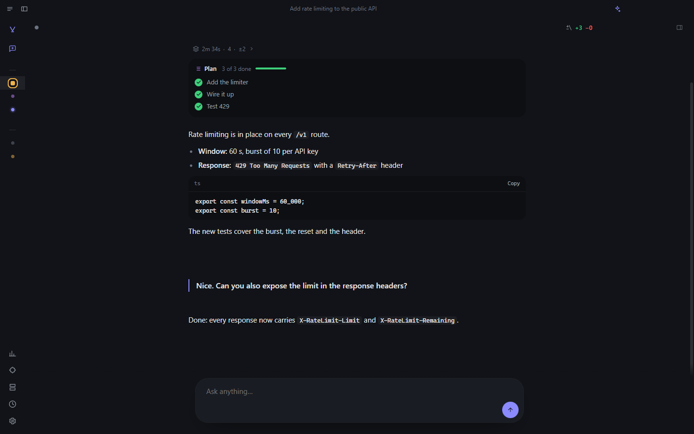

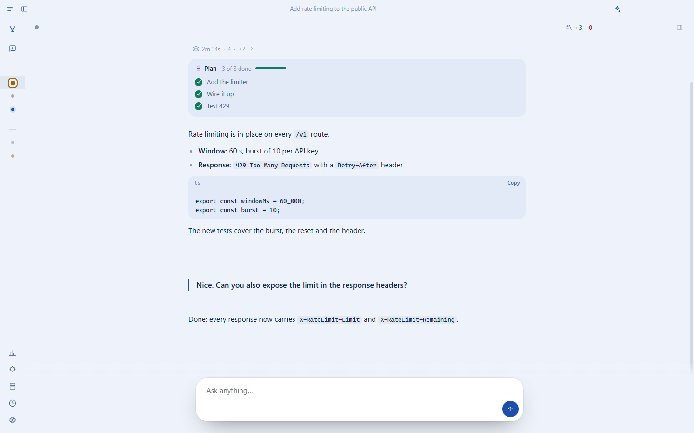

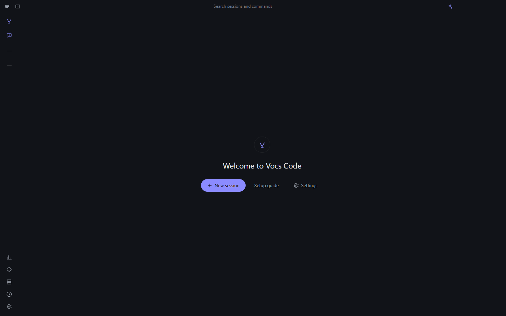

### Mono

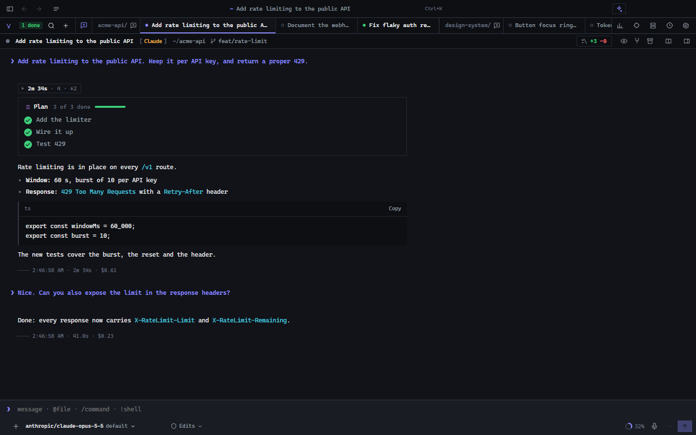

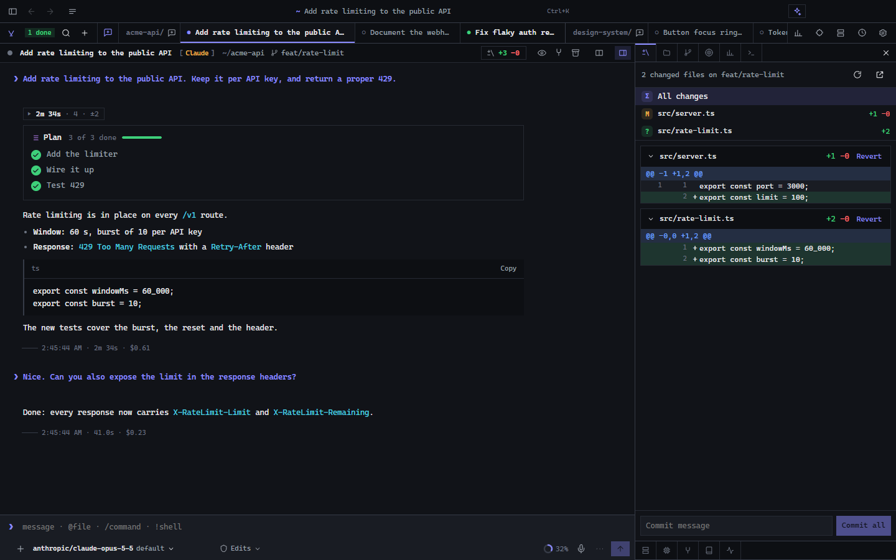

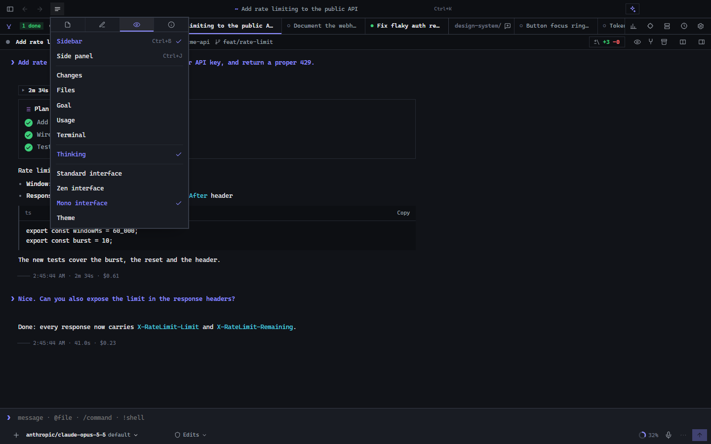

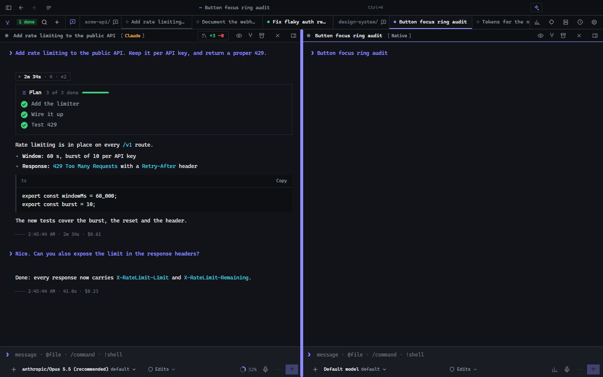

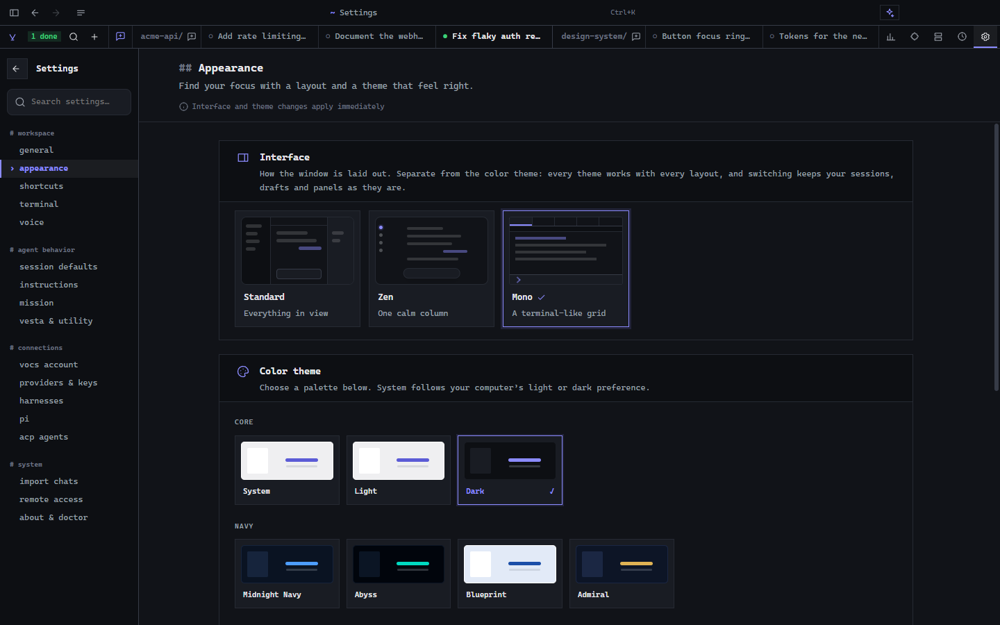

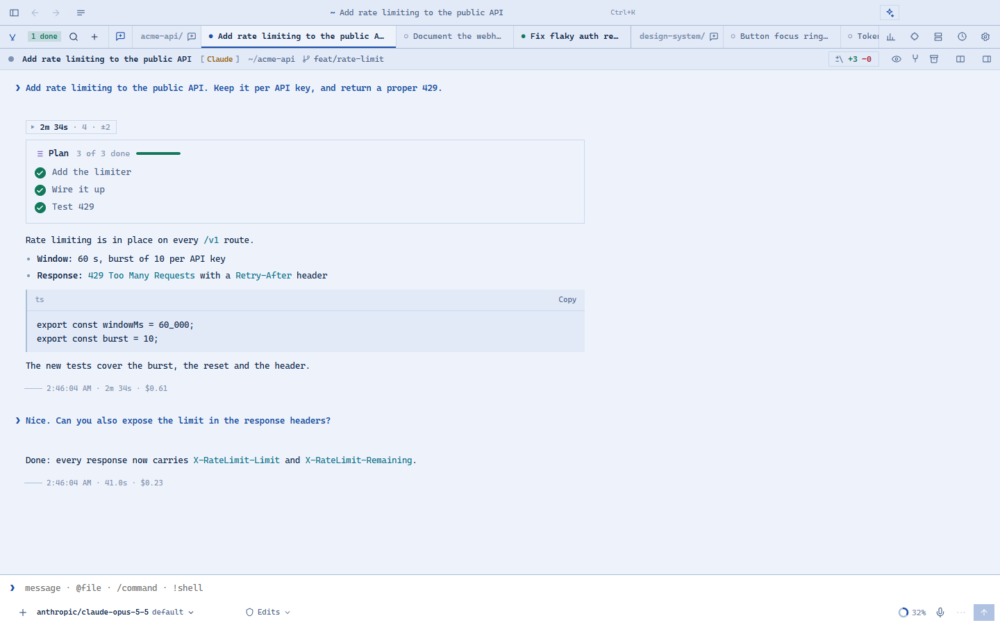

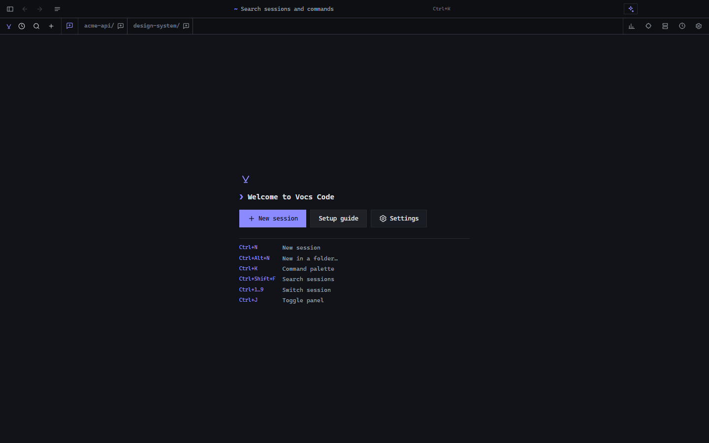

### Where the choice lives

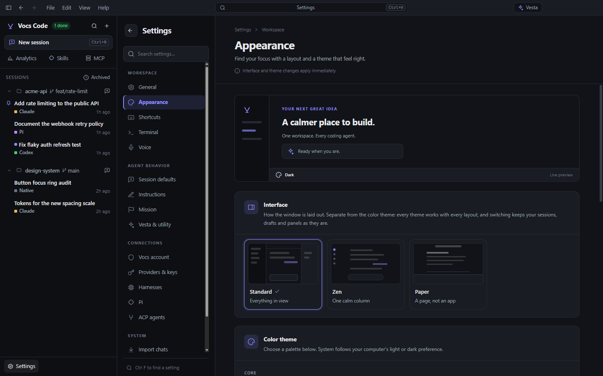
