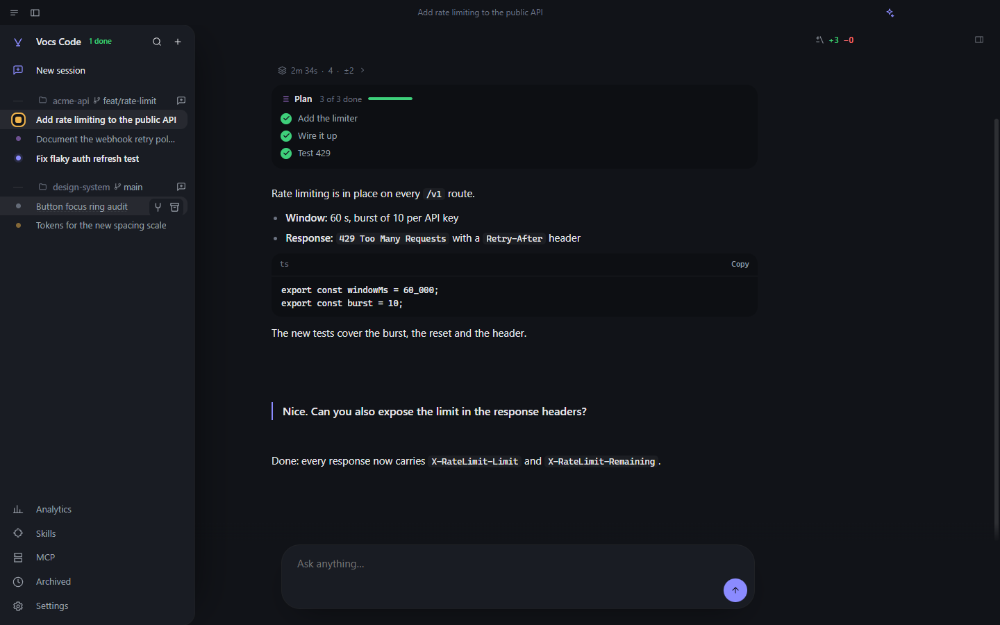
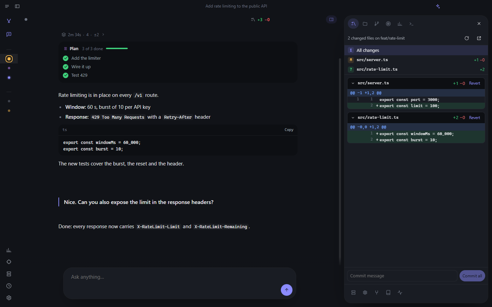
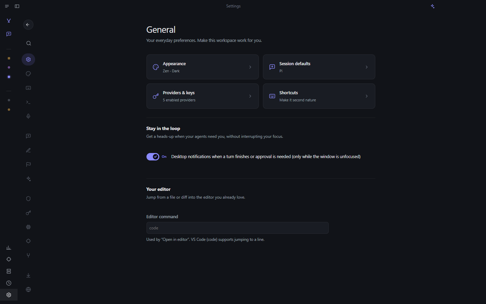

# Interface modes

Settings → Appearance → **Interface** picks how the window is laid out: **Standard**, or the
minimalist **Zen** layout. It is a separate choice from the color theme. Every theme works in both,
and View in the menu bar and the command palette ("Switch to the … interface") switch it too.

## What each mode is

**Standard** is the full layout: a labelled sidebar, the session header, the side panel and the
File / Edit / View / Help menu bar.

**Zen** — one calm column. Chrome stays quiet until it is reached for.

- Sessions are a rail of dots. Each dot takes its harness's hue, carries a ring when its session is
  open, an accent fill when it finished unseen, and breathes blue while working or red while waiting
  on you. A pinned session's dot is a rounded square. Folders are short rules. Hovering the rail (or
  tabbing into it) slides the full list open over the conversation.
- The conversation is one centered column. Your messages read as lines with an accent rule rather
  than bubbles. A turn's work is its bare numbers (`2m 34s · 4 · ±2`). A completed turn's footer
  appears only when pointed at; a failed or interrupted one stays visible.
- The composer is a floating pill. Its model, permission, attach and voice controls appear when you
  point at it or tab into them; Send never hides.
- The side panel mirrors the session rail on the right edge: one series of icons, the workspace views
  (Changes, Files, Git, Goal, Usage, Terminal), a short rule, then the live services (MCP, Desktop,
  Subagents, Knowledge, Processes). The rail says what it can without opening: a dot on Changes while
  the tree has uncommitted work, a live dot on an active goal, a count on processes left running.
  Hovering it, or tabbing or typing into it, slides out a drawer wider than the Standard panel
  (at least 560px) over the conversation. The drawer shows one view at a time, named in its head, and
  folds back once the pointer and focus have left. Something that asks for the panel without the
  pointer (a file link, the branch crumb, the usage meter) makes it peek out until a press lands
  elsewhere. The rail stands in for the header's panel toggle and changes chip.
- Either side can be pinned open (the pin at the top of the open sidebar, and in the drawer's head).
  A pinned side owns its room and the column moves out of its way; unpin to fold it back to its rail.
  Pins are kept per window in localStorage, so they survive a restart.
- The title bar keeps only the menu, where you are and Vesta. File / Edit / View / Help fold into one
  menu button whose panel switches menus by icon. Back and forward appear when the bar is pointed
  at. Labels the layout drops become tooltips, so no destination disappears.
- Settings becomes an icon rail. Hover over it or tab to a section to reveal the full menu
  over the page.

## How it is built

- `src/shared/ui-modes.ts` is the catalogue; `AppSettings.uiMode` stores the choice, and
  `normalizeSettings` turns anything unknown back into `standard`.
- `applyUiMode` (`src/renderer/src/theme.ts`) sets `<html data-ui>`. `ui-zen.css` is scoped to
  `:root[data-ui='zen']` and restyles the **standard** component tree. Switching therefore changes
  one attribute: nothing remounts, so the open session, an unsent draft, a running turn, terminals
  and the side panel all survive a switch.
- React reads the mode (`src/renderer/src/ui-mode.ts`) only where the layout needs different markup:
  the one-button menu, tooltips for labels the layout hides, the composer placeholder, the pin
  buttons, and the side panel's rail and drawer head, which replace its two tab strips. The panel's
  bodies stay where they are in the tree, so a switch still remounts nothing. The store keeps which
  half was picked last (`panelFocus`), the peek (`panelPeek`) and the pins (`pins`, saved by
  `src/renderer/src/pins.ts`); the panel exposes them to the CSS as `data-focus`, `data-peek` and
  `data-pinned`, and `.app` carries `pin-left` / `pin-right`. The CSS
  also reads a few data hooks:
  - `data-status`, `data-harness` and `data-pinned` on session rows;
  - `data-short` on the work chip (its facts without words);
  - the `turn-*` span classes on turn footers.
- Tokens are overridden on `:root[data-ui='zen'][data-theme]` so they outrank the injected theme
  blocks.

In both modes, the transcript and composer grow with the pane up to a shared maximum. Prose has
its own narrower line length. Markdown tables size to their content and scroll horizontally within
the message when they don't fit; focus the table and use the arrow keys to scroll it.

When you change a component Zen restyles (sidebar, header, transcript, composer, side panel,
settings), look at it in Zen too. `tests/e2e.ui-modes.test.ts` covers switching, Zen's geometry,
responsive conversation sizing, state surviving a switch and restart persistence; see
[TESTING.md](TESTING.md) for the change → suite row.

## Review screenshots

Captured from the real Electron app with an isolated, seeded fixture (no live conversations or
credentials), dark theme unless noted.

### Where the choice lives

