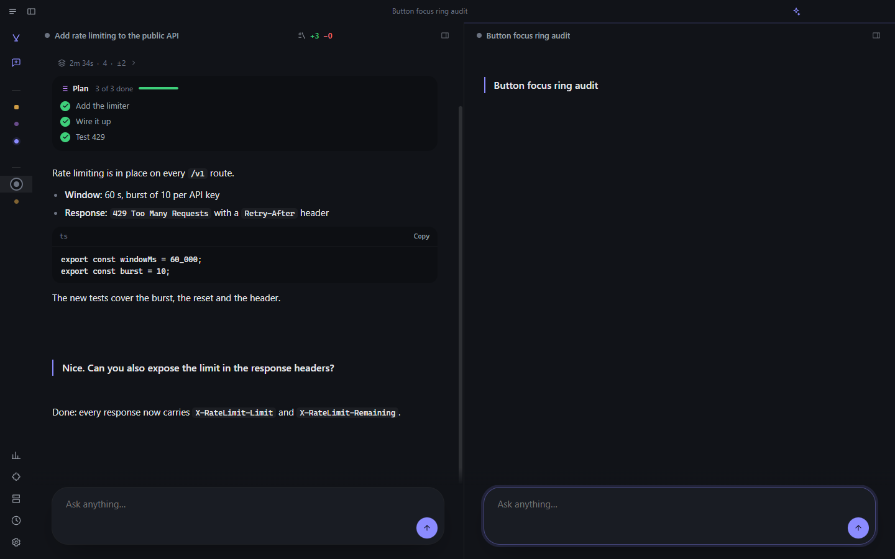
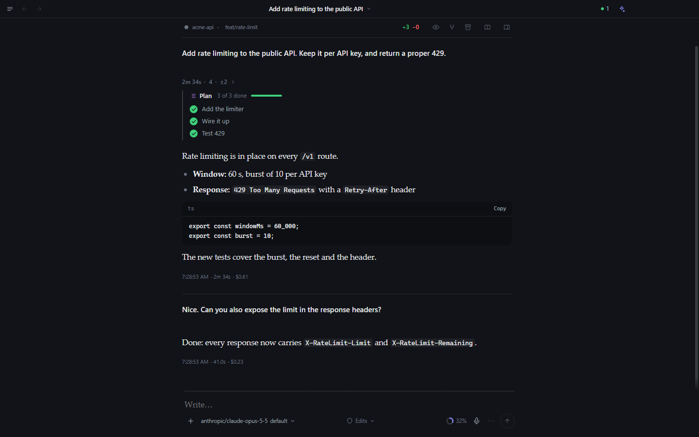
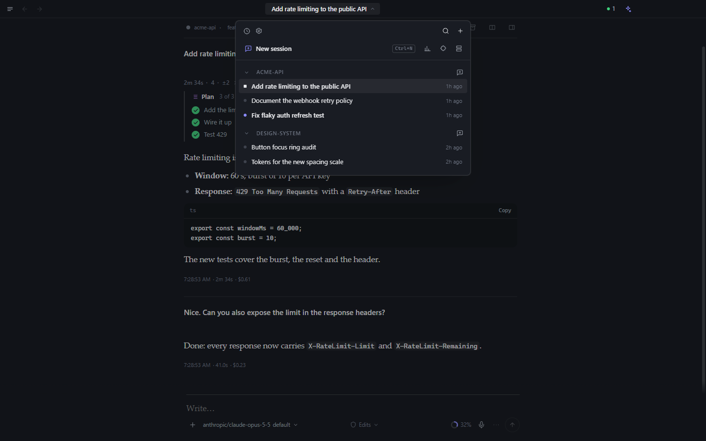
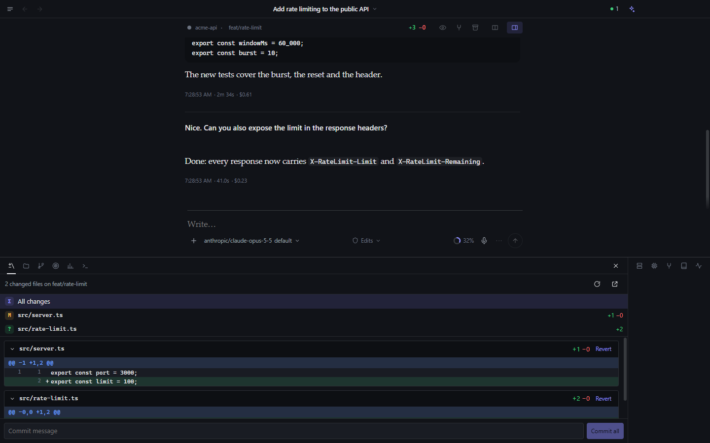
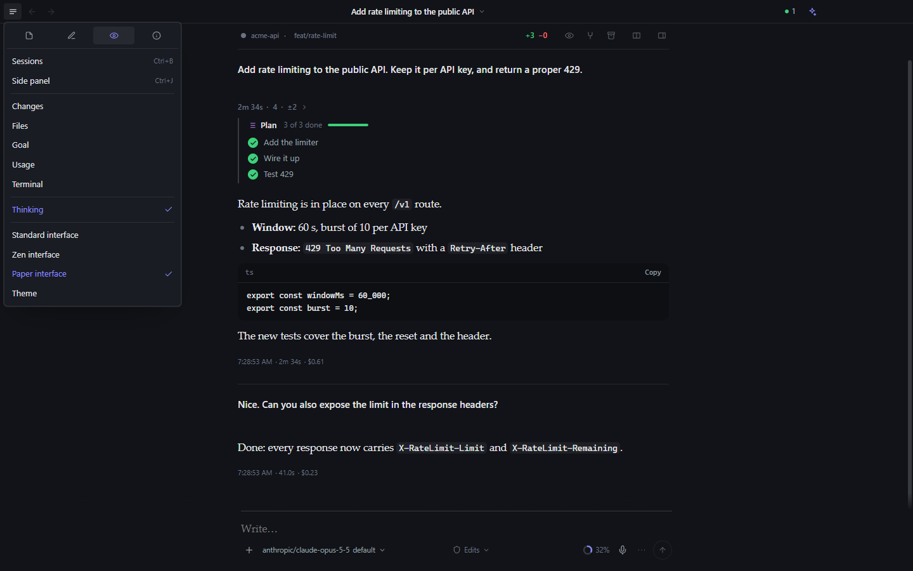
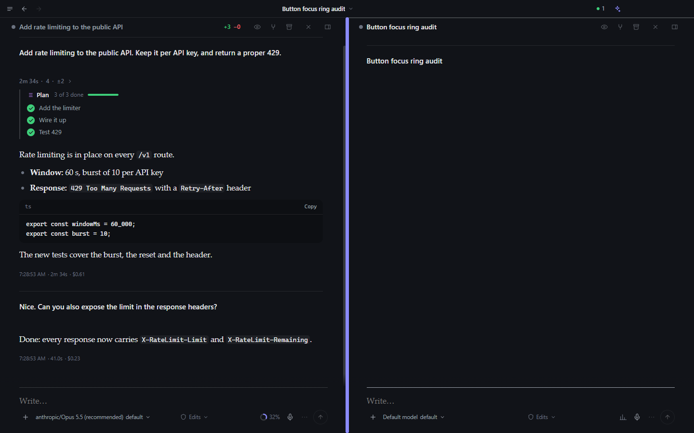
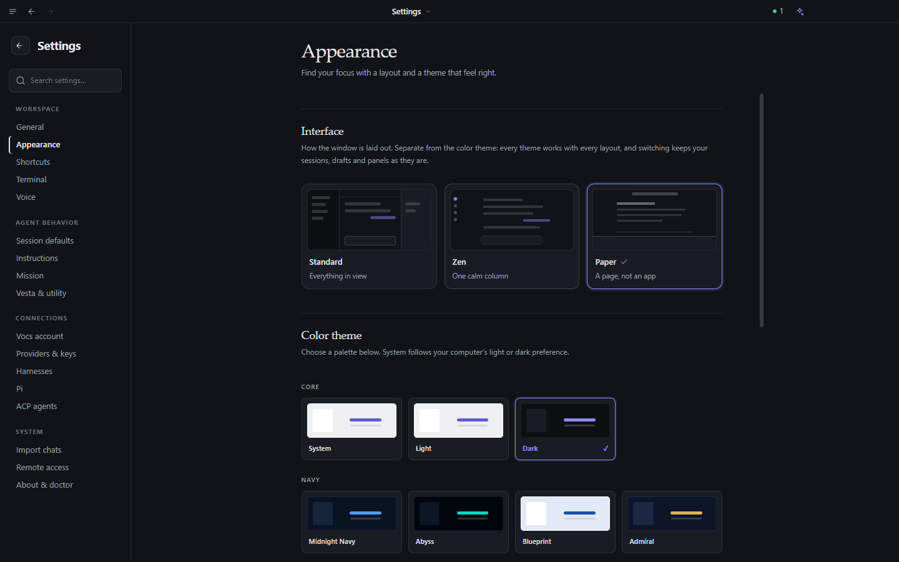
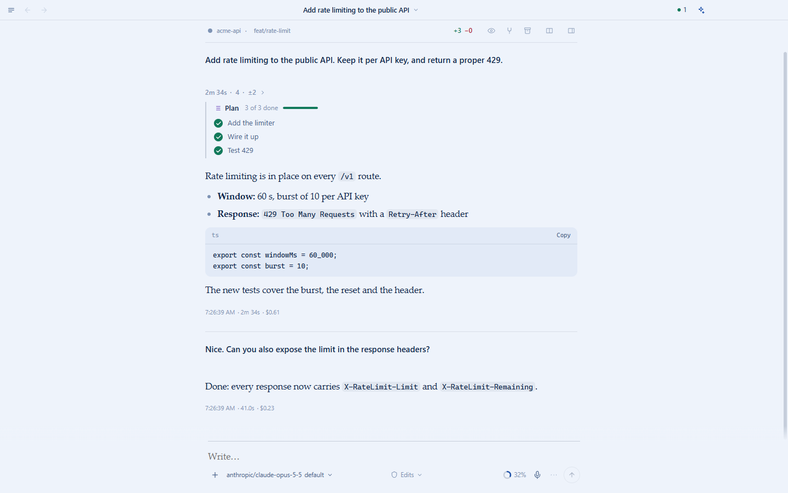
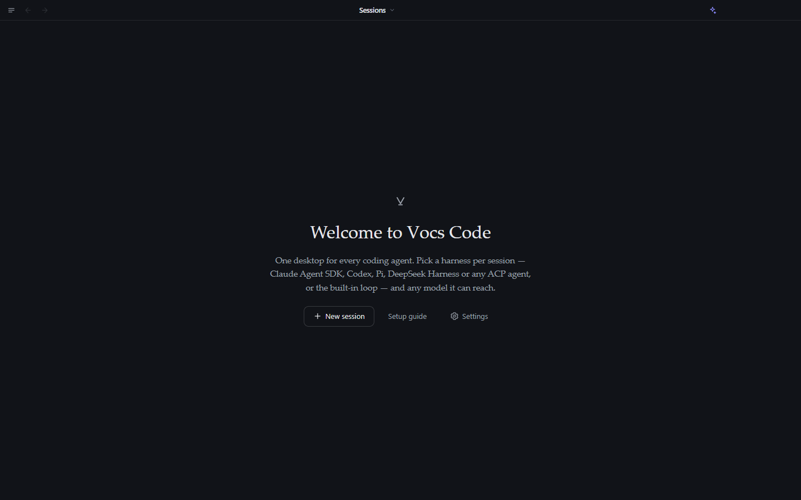

# Interface modes

Settings → Appearance → **Interface** picks how the window is laid out: **Standard**, or one of two
minimalist layouts, **Zen** and **Paper**. It is a separate choice from the color theme. Every theme
works in every mode, and View in the menu bar and the command palette ("Switch to the … interface")
switch it too.

## What each mode is

**Standard** is the full layout: a labelled sidebar, the session header, the side panel and the
File / Edit / View / Help menu bar.

**Zen** — one calm column. Chrome stays quiet until it is reached for.

- Sessions are a rail of dots. Each dot takes its harness's hue, carries a ring when its session is
  open, an accent fill when it finished unseen, and breathes blue while working or red while waiting
  on you. A pinned session's dot is a rounded square. Folders are short rules. Hovering the rail (or
  tabbing into it) slides the full list open over the conversation.
- The conversation is one centered reading column. Your messages read as lines with an accent rule
  rather than bubbles. A turn's work is its bare numbers (`2m 34s · 4 · ±2`). A completed turn's
  footer appears only when pointed at; a failed or interrupted one stays visible.
- The composer is a floating pill. Its model, permission, attach and voice controls appear when you
  point at it or tab into them; Send never hides.
- The side panel is a drawer floating beside the column, with icon tabs. The column moves out of its
  way rather than hiding under it.
- The title bar keeps only the menu, where you are and Vesta. Back and forward appear when the bar is
  pointed at. Settings becomes an icon rail with an expanding search.

**Paper** — a page, not an app. Flat surfaces, hairline rules, no cards.

- There is no sidebar. The title bar names the session you are in; clicking it (or Ctrl+B, or View →
  Sessions) drops the session list down beneath it as a switcher. The list keeps every action the
  sidebar has: new session, the other places as icons, archived, settings, search and new folder,
  with one line per session (a state dot, the title, its age). Picking a session, Escape or a click
  outside closes it. Clicking a title opens that session; rename by double-click or the menu.
- What is running, waiting on you or finished elsewhere shows as three coloured numbers by Vesta,
  opening the same activity tray.
- The conversation is set like a printed page under a small-caps dateline (folder · branch): your
  words open each exchange as a sans line under a hairline rule, the agent's answer is in a book
  serif, and a turn's work and footer are quiet lines of figures.
- The composer is a single ruled line written in the same serif.
- The side panel is a sheet along the bottom of the window, its two halves side by side.
- Settings is a contents list beside a serif page.

Both minimalist modes fold File / Edit / View / Help into one menu button whose panel switches menus
by icon. Labels the layout drops become tooltips, so no destination disappears.

## How it is built

- `src/shared/ui-modes.ts` is the catalogue; `AppSettings.uiMode` stores the choice, and
  `normalizeSettings` turns anything unknown back into `standard`.
- `applyUiMode` (`src/renderer/src/theme.ts`) sets `<html data-ui>`. `ui-zen.css` and
  `ui-paper.css` are scoped to `:root[data-ui='zen']` / `:root[data-ui='paper']` and restyle the
  **standard** component tree. Switching changes one attribute and never remounts a session pane, so
  the open session, an unsent draft, a running turn, terminals and the side panel all survive a
  switch.
- React reads the mode (`src/renderer/src/ui-mode.ts`) only where a layout needs different markup:
  the one-button menu, tooltips for labels the layout hides, the composer placeholder, and Paper's
  switcher. Paper renders the sidebar only while the store's transient `switcherOpen` is set. That
  flag is separate from `sidebarOpen`, so a mode switch never changes whether the Standard or Zen
  sidebar shows. The CSS also reads a few data hooks:
  - `data-status`, `data-tone` and `data-pinned` on session rows;
  - `data-short` on the work chip (its facts without words);
  - the `turn-*` span classes on turn footers.
- Tokens are overridden on `:root[data-ui=…][data-theme]` so they outrank the injected theme blocks.

When you change a component either mode restyles (sidebar, header, transcript, composer, side panel,
settings), look at it in Zen and Paper too. `tests/e2e.ui-modes.test.ts` covers switching, each
layout's geometry, Paper's switcher, state surviving a switch and restart persistence; see
[TESTING.md](TESTING.md) for the change → suite row.

## Review screenshots

Captured from the real Electron app with an isolated, seeded fixture (no live conversations or
credentials), dark theme unless noted.

### Zen

### Paper

### Where the choice lives

