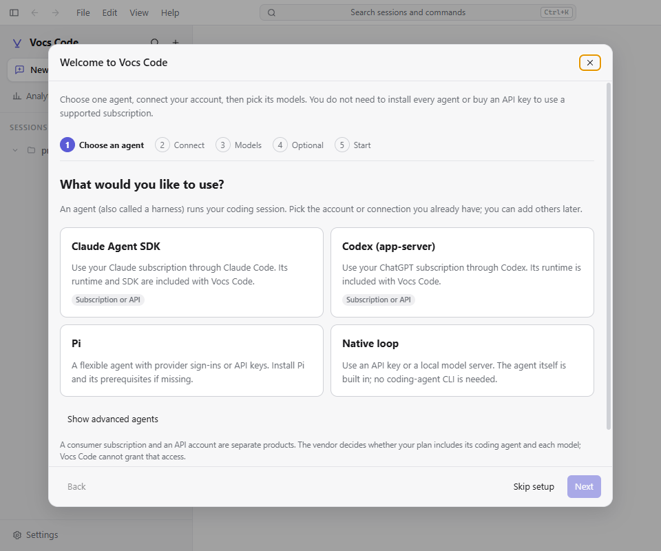
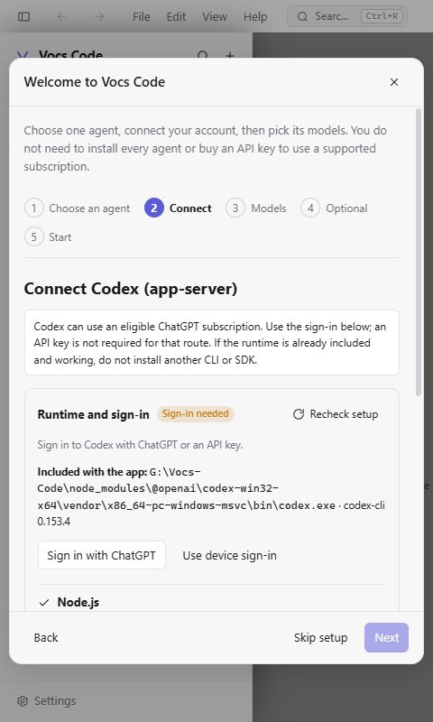
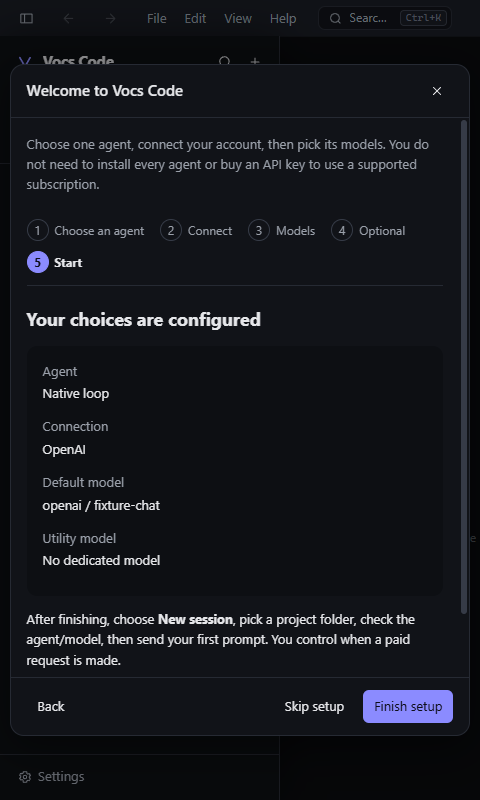

# First-time setup and recovery

The guide sets up **one working agent**, not every engine or utility service. Open it on first run,
from Home → **Setup guide**, Settings → **Harnesses**, the **Harness logins** card in Providers &
keys, or New Session → **Set up / sign in**. The New Session overlay keeps the unsent prompt and
options beneath it. Closing setup refreshes that dialog's catalog rather than reusing an old
sign-in failure.

## Five steps

1. **Choose an agent.** Claude and Codex support eligible vendor subscriptions; Native uses an API
   key or local server; Pi supports its provider sign-ins and API credentials. Other engines are
   under advanced choices. A consumer subscription and an API account are different products.
2. **Connect.** Inspect the selected executable, app SDK and prerequisites. Install only what is
   missing, sign in through the vendor's flow, or explicitly save an API key. Then **Recheck setup**.
3. **Models.** Check the catalog and select a model, or let a subscription-backed agent choose its
   default. Failed requests can show fallback suggestions, but those are not verified access.
   An explicit unverified bypass permits exploration without labelling setup ready.
4. **Optional.** A dedicated utility model and Vesta are separate from the coding-session route.
   They are not prerequisites for using Claude or ChatGPT subscriptions. API utilities can have
   separate billing; configure them later in Settings → Vesta & utility if needed.
5. **Start.** Finish saves the default harness/model and utility choice. Choose New session, check
   the project, agent and model, then send the first prompt yourself. Existing sessions and
   remembered per-project session choices are not rewritten.

**Finish setup** and **Skip setup** explicitly persist completion. **×** only dismisses an unfinished
setup for this app run; it returns on restart and can always be reopened. Importing conversations
is optional and does not mark onboarding complete. Unsaved API-key drafts survive Back/Next and
visits to Import within the guide; dismissing the guide does not persist those drafts.

## Subscription and API routes

- **Claude:** Sign in with Claude runs the selected runtime's `auth login --claudeai`. The API route
  is a separate, explicit choice and uses the existing Claude `useProviderKey` setting. Installing
  a second CLI is not required when the app's bundled runtime and SDK work.
- **Codex:** Sign in with ChatGPT runs the selected runtime's `login`; device sign-in adds
  `--device-auth`. Configured OpenAI/Codex environment or app API credentials can affect billing
  even when CLI status detects a subscription. The guide warns about this; it does **not** change
  existing adapter credential precedence. For subscription-only intent, review those keys before
  sending a prompt.
- **Pi:** The guide launches Pi without sessions, extensions, skills, prompt templates or themes.
  Run `/login` there, finish the provider flow, then return and recheck. A Pi installation currently
  requires Node.js 22.19+ and npm. Its provider/model availability depends on that installation.
- **Native/local:** Choose a configured API provider or local server. Local servers do not require
  a cloud key. Start the server and expose its model catalog; retry when it becomes available.
  Endpoint/model customization remains in Settings → Providers & keys.
- **Other engines:** Cursor needs its API access, and ACP requires a configured agent. A consumer
  desktop-app subscription must not be presented as interchangeable with these API credentials.

A successful launcher is **not** successful authentication. Executable availability, configured
credentials, CLI-reported sign-in, a returned catalog, and paid model entitlement are distinct.
Neither a saved key nor a catalog response proves quota, plan inclusion or the validity of every
listed model. Setup sends no coding-session or paid test prompt; it only probes runtimes and
requests model metadata. Vendor sign-in and installation are explicit actions.

## Missing components and retry

- Node/npm are installer prerequisites, not requirements for an already-working native bundled
  Claude/Codex executable. Git is needed for repository/worktree features.
- A missing app SDK is repaired by repairing/reinstalling Vocs Code, **not** installing an unrelated
  CLI. A missing bundled-only runtime is also a repair case; it no longer silently selects a
  different PATH executable. Explicit binary overrides still take precedence.
- A pinned executable or bundled selection is not replaced by the guide's npm installer. Change
  the runtime choice explicitly in Settings → Harnesses if a replacement is intended.
- Installation failures retain the log and allow retry. Installer success triggers another check;
  it is not proof that the selected binary changed to the registry's latest version.
- After installing a prerequisite, restart Vocs Code if its environment/PATH changed, then recheck.
  If a terminal cannot be opened, the guide reports failure and retains retry controls.

## Credential and authorization boundaries

Keys are submitted only by **Save key**, via the existing `secrets:set` vault boundary. Failed saves
retain the draft; a late acknowledgment clears only the submitted value, not newer edits. The
wizard cannot advance or close while its credential save is pending. If OS encryption is
unavailable, it explains the fallback and requires acknowledgment before the first write.

`harness:setup` exposes requirement and credential-source flags, not key values or vendor account
identifiers. `harness:login` accepts only a supported harness and optional device flag. Only the
local desktop owner's main frame may launch it: renderer-supplied executables, arguments, working
directories and authority fields are rejected, and remote/agent channel allowlists do not expose
it. Main chooses the resolved runtime, fixed vendor arguments and a private, non-project working
directory. Windows quoting uses encoded PowerShell; macOS uses a quoted, self-removing launcher;
Linux passes separate executable/argument entries to a terminal.

Rechecks invalidate PATH/probe caches. Runtime, main availability, renderer availability and
catalog request ordering prevent discarded in-flight results from reviving stale setup failures.

## Verification

See the onboarding row in [TESTING.md](TESTING.md). Offline tests cover prerequisite decisions,
SDK repair, pinned/bundled runtime intent, unknown authentication, fixed launch arguments and
quoting, desktop dispatch authorization, stale checks, draft/save failures, and modal focus.

The guarded `e2e.models`, `e2e.vision` and `e2e.instructions` suites exercise clean profiles, real
IPC and persistence, first-run choices, Settings/Home recovery, dismissal versus skip/restart,
import, compact layout, subscription choices without mandatory API keys, and API/local catalog
failure → retry → model persistence → restart. API tests use only a fake key and a loopback server;
they assert catalog request counts and no coding session creation. Vendor credential homes and
Windows APPDATA/LOCALAPPDATA must exist as isolated directories: Codex refuses a nonexistent
explicit CODEX_HOME. The OpenAI-wire catalog client retries a 503 once before reporting failure.

Screenshots from isolated Electron profiles are generated under `tests/artifacts/onboarding-*.png`.
Offline launcher tests are not live OAuth certification. Real vendor consent/login, paid access,
macOS/Linux terminal UX and packaged-installer repair still require separate qualification; do not
infer those from catalog checks or from a green Windows development-build suite.

## Reviewed screenshots

These are the real development app on the current session-view layout, using isolated fixtures,
not mockups. The API model in the summary is a loopback fixture, not evidence of paid model access.

