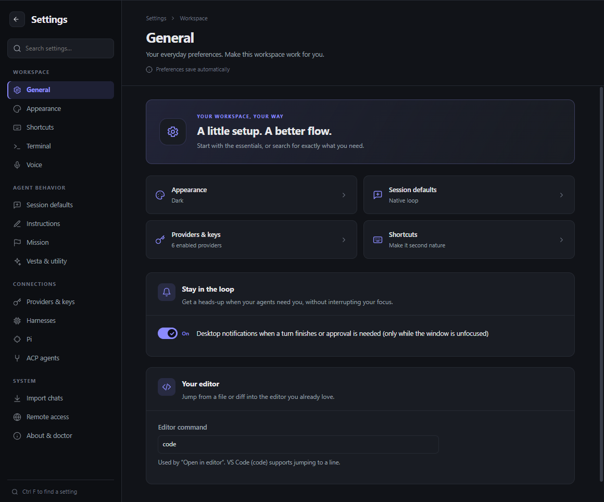
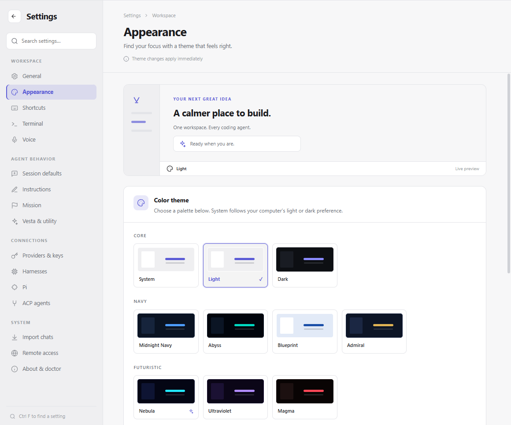
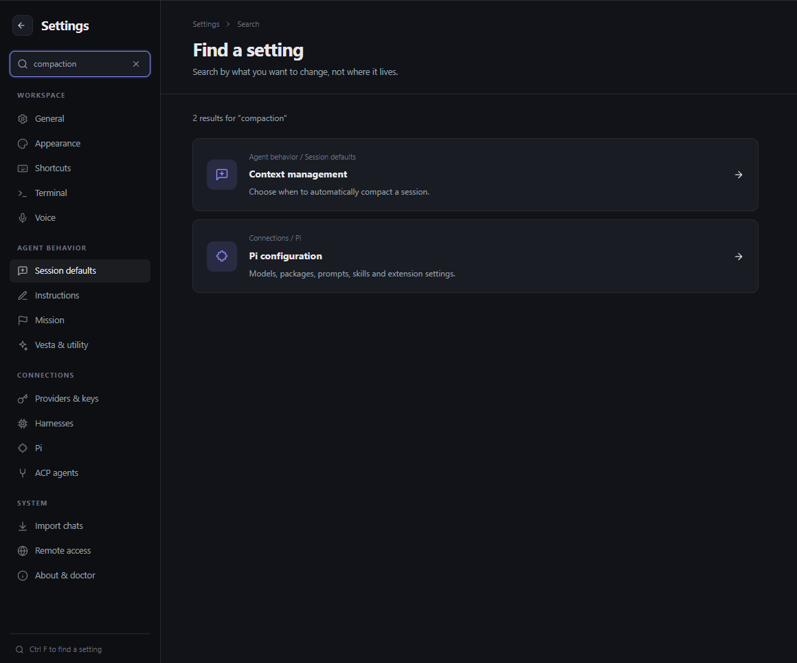
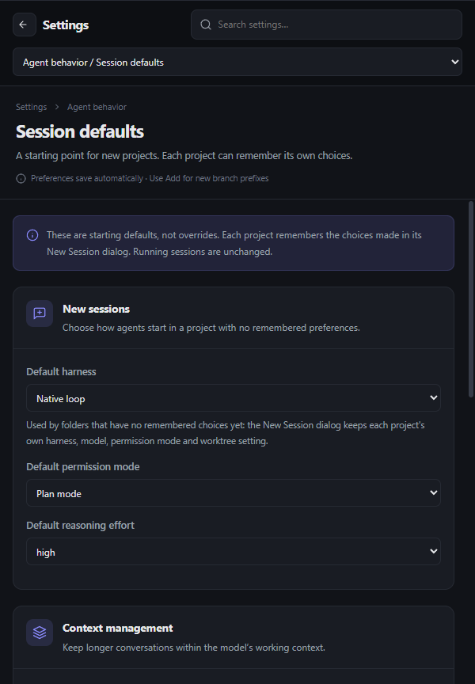

# Settings UX

Settings is organized around tasks rather than storage files. Existing IPC, configuration owners,
keychain boundaries, permissions and save semantics are unchanged.

For first-time setup or recovery, open **Harnesses → Setup guide**, a per-harness **Set up** action,
or **Providers & keys → Harness logins → Sign in / setup**. The guide separates subscription
sign-in from API keys, detects selected-runtime prerequisites, and checks models without sending
a coding prompt. See [First-time setup and recovery](ONBOARDING.md) for billing caveats, explicit
save/dismissal behavior and repair paths.

**Providers & keys → Harness logins → Refresh models** re-probes Pi, Codex or Claude without
installing a runtime or sending a prompt. The Codex action refreshes both Codex adapters. Results
are shared with existing session pickers and New Session; new models are appended to a running
session’s startup list without replacing its model metadata. Pi, Claude and Codex sessions remain
limited to their reported providers, and ACP keeps its session-advertised list. A failed refresh
shows the error and retains the last usable catalog for the current provider/runtime configuration.
Newly added credentials or runtime-only model changes may require restarting an existing harness
process; discovery does not guarantee that process or account can use every listed model. **Refresh logins** checks runtime
availability/sign-in only; **Check for updates** checks CLI versions.

## Find the right page

| Group | Pages |
| --- | --- |
| Workspace | General, Appearance, Shortcuts, Terminal, Voice |
| Agent behavior | Session defaults, Instructions, Vesta & utility |
| Connections | Vocs account, Providers & keys, Harnesses, Pi, ACP agents |
| System | Import chats, Remote access, Housekeep, About & doctor |

General is the starting point for daily preferences and common destinations. Appearance owns the
interface mode (Standard, or the minimalist Zen layout), the live theme preview and the theme
catalogue; the interface and the color theme are independent, and every theme works in both. See
[Interface modes](INTERFACE-MODES.md). Session defaults owns new-session defaults, compaction,
goals and worktree branch prefixes. Remembered per-project choices still take precedence for
new-session harness, permission and effort defaults. Compaction is app-wide and can affect existing
sessions at an idle boundary; the harness-native `/goal` preference updates existing sessions too.
Auto-continue and iteration defaults are copied when a new goal is created.

**Housekeep** configures `/housekeep` on the desktop. It protects sessions used in the last
**7 days** by default, counting the latest session creation, update, view, or transcript activity. Save a whole
number from 0 to 3650; 0 turns off only age protection, not the other protections. The age rule is
checked again before archiving. A review without an override uses the current setting at that check.

Run `/housekeep sessions` (or the built-in **Housekeep sessions** skill) to preview older sessions one
by one. Add a whole number from 0 to 3650, such as `/housekeep 3`, to set the protection window for
that review only. It applies through confirmation and does not change the saved setting. Review
locally, or explicitly ask your configured utility model to assess short conversation
excerpts. Results are recommendations and never archive anything before a separate confirmation.
Sessions with local files, including Git-ignored files, are left alone. Clean worktrees go to the
operating system’s Trash (Recycle Bin on Windows), never through permanent deletion. Existing
branches and transcripts are retained. Housekeep is not available to paired browsers or agents.

In the same dialog, choose **Scan worktrees and branches** under **Stranded worktrees and
branches**. This is a read-only inventory of repositories known to this profile through saved
project folders or sessions, including archived ones. It compares Git registrations with direct
entries under `.vocs-code/worktrees`, legacy `.vocs-desk/worktrees`, and repo-relative
`.claude/worktrees` and `.codex/worktrees` when present. It can also show retained local branches
without a registered checkout when an archived session references them or when they use the
`vocscode/` or legacy `harness/` naming convention. Git’s stale-registration flag is shown separately
from whether the folder was found. A session that records the same branch elsewhere isn’t counted
as a checkout path match. An unlinked folder or branch isn’t necessarily abandoned. The scan never
reads checkout contents or scans home directories, never contacts a provider or Git remote, and
never removes folders, prunes registrations, or deletes branches.

- Search finds settings by topic and vocabulary, including controls inside other pages. Enter opens
  the first result; Down moves into results; Escape clears the query even from a focused result and
  returns focus to search. Each new query starts at the top of the result list. Ctrl/Cmd+F focuses
  settings search while focus is in Settings.
- Selecting a result opens its page and focuses its setting group where a target is defined.
- Search hides rather than unmounts the current page, so clearing it preserves an editor’s draft.
- On compact panes, a grouped section selector replaces the sidebar; no destinations disappear.
- Page headers explain save behavior. Immediate preferences are distinct from explicit Save,
  import, connection, installation and security actions; a save hint is not a success indicator.
- Pi separates Preferences, Prompts, Resources, Packages and Subagents without discarding drafts
  when changing category. Instructions exposes scope selection, unsaved state and character count.

## Maintaining the UI

`src/renderer/src/settings-catalog.ts` is the section and search catalogue. Add a topic when adding
an important setting, including user-facing synonyms. Search only indexes static descriptive text:
never configuration values, credentials, user files or model account details. An optional `anchor`
should name the actual visible settings group. `openSettings()` remains the public deep-link entry;
View → Theme opens Appearance directly; View also lists both interfaces, and the command palette offers
"Switch to the … interface" for the one not in use. In Zen, hovering the icon rail or tabbing to a
section opens the full menu over the settings page. The compact-pane section selector takes over
at 650px and below.

`SettingsPrimitives.tsx` provides titled, accessible groups and informational notes. Settings-specific
styles live in `components/settings.css`, scoped to `.settings` so other app surfaces are unaffected.
Use the app’s theme tokens, retain accessible field names and keep native checkboxes out of flexible
text-input width rules.

## Saving and consistency

- An Instructions or Pi prompt save acknowledges only the submitted text. Text edited while the
  request is pending remains an unsaved draft, including after switching scope/category or a failed
  save. Most harnesses load app instructions when starting; the native loop reads them before each
  model step.
- Clearing a Pi numeric override removes its key so the runtime default applies. Valid zero values
  survive reloads; invalid number text is not treated as an intentional deletion. A rejected update
  leaves the confirmed value visible. Vocs Code rereads subagent concurrency limits before each
  spawn, including in running sessions. When `maxConcurrent` is unset, the background/session caps
  are four/eight respectively; a configured value sets both caps.
- Pi snapshots are ordered by successfully applied responses. Refreshes invalidated by an
  overlapping mutation are reconciled after pending mutations settle, including failed mutations;
  a refresh never repeats a package command.
- `PiConfigStore` queues complete reads and read/merge/write operations per resolved agent directory
  across store instances in this process. Package commands hold that queue until their runner
  settles, including the existing best-effort timeout teardown. Other directories are independent.
  Atomic JSON replacement and this queue do **not** provide locking against external Pi processes
  or editors.
- App instruction reads and writes share the UTF-16 character budget used by the editor counter.
  Pi prompt files have a UTF-8 byte budget instead. Oversized previews never end halfway through a
  character and cannot be silently saved back as truncated text.
- External package resources can still be enabled/disabled, but unsupported editor actions are
  disabled and explained. The renderer check is lexical UX only; main-process validation remains
  authoritative and unchanged.

## Review screenshots

The following are curated crops of the real Electron app using an isolated fixture, not mockups.
No live conversations or credentials are included.

### General — dark



### Appearance — light



### Search



### Compact layout



To regenerate the original captures (gitignored):

```sh
npm run build
node scripts/e2e-guard.mjs tests/e2e.layout.test.ts
```

The suite also tests real preference writes, restart persistence, keyboard navigation, provider
filtering, every catalogue search anchor, search reset/Escape, and every page at multiple compact
widths. Section-specific suites continue to exercise their own production
boundaries; the navigation suite is not a substitute for those flows.

## Vocs account

Vocs account is an explicit sign-in with your Vocs identity (`auth.vocs.io`) and a view of your Vocs Hub catalog (`mcp.vocs.io`). Developers can target the staging services by launching with `VOCS_CODE_ACCOUNT_REALM=staging`; the page then shows a Staging only badge. Credentials stay in the main process; the settings page receives only safe descriptive status. Sign-in uses the system browser, cancellation and sign-out clear local account state, and sessions are memory-only for at most five minutes. Local work remains available signed out. Viewing a connection neither installs it nor authorizes tools or paid execution.

**Hub connections.** Each catalog connection that needs its own authorization has a **Connect** button. Connect opens the Hub's consent page in the system browser (a separate approval on `mcp.vocs.io`, with the account's scopes); Cancel stops a pending one. Connected shows the granted scopes and **Disconnect**. While connected, new agent sessions on this computer get the connection's tools as `vocs-openrouter` (through a local proxy; the Hub token stays in Vocs Code), and the connection is kept in the OS keychain across restarts, also after a temporary sign-in ends; a connection still held while signed out is listed with Disconnect. Disconnect, signing out, signing in with a different account or the connection leaving the catalog ends it and revokes it on the Hub. A connection revoked on the Hub dashboard shows "Disconnected on mcp.vocs.io — connect again". See [desktop acceptance](ACCOUNT-STAGING-TEST.md) and [MCP](MCP.md#vocs-mcp-hub-connections-app-owned-vocs-openrouter).
