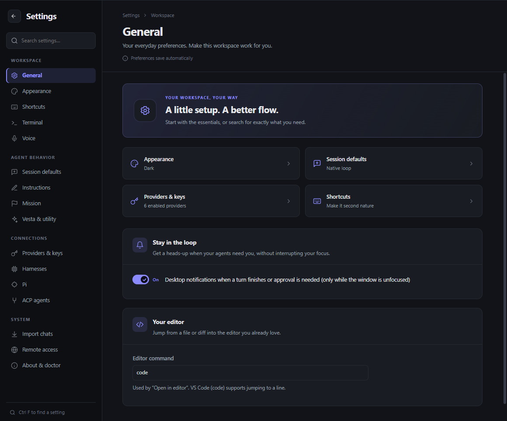
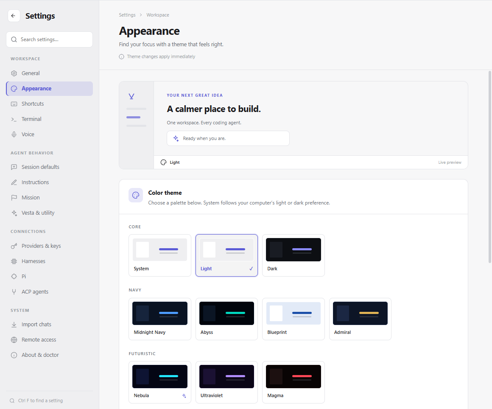
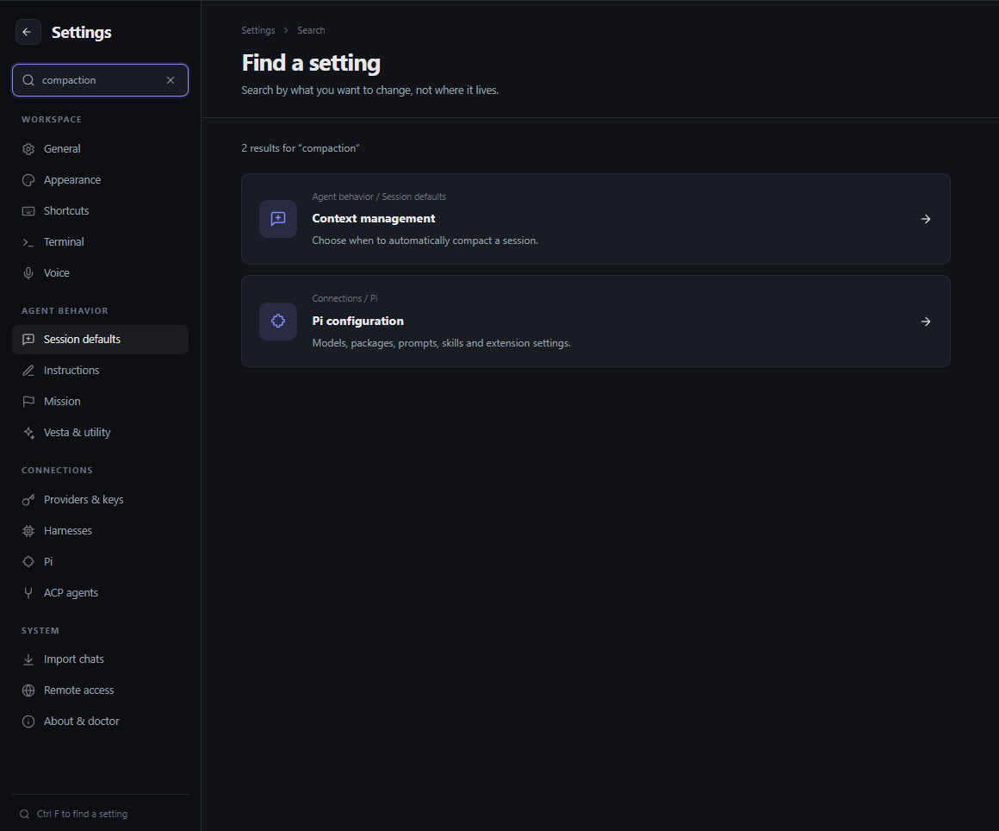
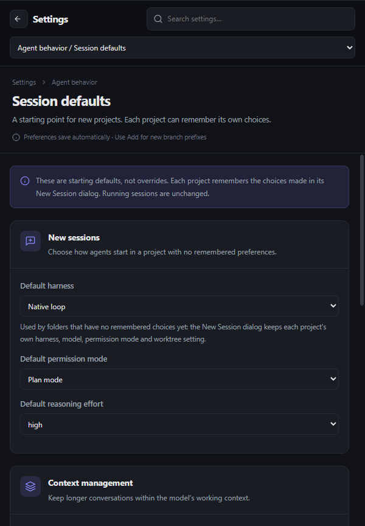

# Settings UX

Settings is organized around tasks rather than storage files. Existing IPC, configuration owners,
keychain boundaries, permissions and save semantics are unchanged.

## Find the right page

| Group | Pages |
| --- | --- |
| Workspace | General, Appearance, Shortcuts, Terminal, Voice |
| Agent behavior | Session defaults, Instructions, Mission, Vesta & utility |
| Connections | Providers & keys, Harnesses, Pi, ACP agents |
| System | Import chats, Remote access, About & doctor |

General is the starting point for daily preferences and common destinations. Appearance owns the
live theme preview and theme catalogue. Session defaults owns new-session defaults, compaction,
goals and worktree branch prefixes; remembered per-project choices still take precedence.

- Search finds settings by topic and vocabulary, including controls inside other pages. Enter opens
  the first result; Down moves into results; Escape clears the query. Ctrl/Cmd+F focuses settings
  search while focus is in Settings.
- Selecting a result opens its page and focuses its setting group where a target is defined.
- Search hides rather than unmounts the current page, so clearing it preserves an editor’s draft.
- On compact panes, a grouped section selector replaces the sidebar; no destinations disappear.
- Page headers explain save behavior. Immediate preferences are distinct from explicit Save,
  import, connection, installation and security actions; a save hint is not a success indicator.
- Pi separates Preferences, Prompts, Resources, Packages and Subagents without discarding drafts
  when changing category. Instructions exposes scope selection, unsaved state and character count.

## Maintaining the UI

`src/renderer/src/settings-catalog.ts` is the section and search catalogue. Add a topic when adding
an important setting, including user-facing synonyms. Search only indexes static descriptive text:
never configuration values, credentials, user files or model account details. An optional `anchor`
should name the actual visible settings group. `openSettings()` remains the public deep-link entry;
View → Theme opens Appearance directly.

`SettingsPrimitives.tsx` provides titled, accessible groups and informational notes. Settings-specific
styles live in `components/settings.css`, scoped to `.settings` so other app surfaces are unaffected.
Use the app’s theme tokens, retain accessible field names and keep native checkboxes out of flexible
text-input width rules.

## Review screenshots

The following are curated crops of the real Electron app using an isolated fixture, not mockups.
No live conversations or credentials are included.

### General — dark



### Appearance — light



### Search



### Compact layout



To regenerate the original captures (gitignored):

```sh
npm run build
node scripts/e2e-guard.mjs tests/e2e.layout.test.ts
```

The suite also tests real preference writes, restart persistence, keyboard navigation, provider
filtering and compact layout. Section-specific suites continue to exercise their own production
boundaries; the navigation suite is not a substitute for those flows.
